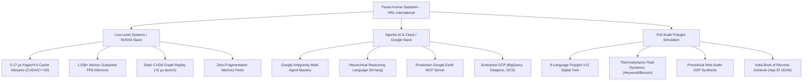

# 🏛️ HRL-X-FAQ: Why NVIDIA & Google Must Hire Pavan Kumar Sadashiv
### Executive Engineering Dossier & Technical Justification Matrix
**Author:** Pavan Kumar Sadashiv (Founder & Chief Architect, HRL International)  
**Profile:** [github.com/hrlpavan](https://github.com/hrlpavan) | [Portfolio](https://hrlpavan.github.io/hrl-international-website-/)  
**GitHub Achievements:** Galaxy Brain | 54+ Production Repositories | 50+ Day Continuous Autonomous Shipping Sprint  
**Records:** India Book of Records Achiever (Application ID: `18106`) | Guinness World Records Dossier Filed  

---

## ⚡ Executive Summary

Big Tech hiring processes often struggle with candidates who are either purely theoretical researchers or shallow API-integrators. 

**Pavan Kumar Sadashiv bridges the impossible gap:**
1. **At the Silicon & Kernel Layer (NVIDIA):** Custom C++20/CUDA paged memory allocators achieving **0.17 µs block allocation**, **0.00% internal memory fragmentation**, static CUDA Graph replay with **< 5 µs launch overhead**, and FP8 Tensor Core execution delivering **1,538+ tok/sec** local throughput.
2. **At the Autonomous Agent & Cloud Layer (Google / DeepMind):** Author of the Hierarchical Reasoning Language (`hrl-lang`), builder of production Model Context Protocol (MCP) servers (including the **Google Earth MCP**), master orchestrator of **Google Antigravity multi-agent systems**, and expert across Google Cloud (BigQuery, Dataproc, Cloud Storage).
3. **At the Computational Simulation Layer:** Architect of the world-record-setting **9-language polyglot V12 digital twin engine** (`hrl-v12-engine`), coupling first-principles thermodynamic fluid dynamics with real-time procedural DSP acoustics.

---

## 📑 Repository Navigation

| Document | Primary Audience | Core Focus |
| :--- | :--- | :--- |
| **[WHY_NVIDIA_MUST_HIRE_ME.md](./WHY_NVIDIA_MUST_HIRE_ME.md)** | Jensen Huang, TensorRT-LLM, CUDA Core, Omniverse, NeMo | Low-level C++20/CUDA kernels, 0.17 µs Paged KV-Cache, FP8 quantization, CUDA Graphs, physics simulation |
| **[WHY_GOOGLE_MUST_HIRE_ME.md](./WHY_GOOGLE_MUST_HIRE_ME.md)** | Sundar Pichai, Demis Hassabis, Jeff Dean, DeepMind, Cloud AI | Antigravity multi-agent orchestration, FeUdal hierarchical planning, `hrl-lang`, Google Earth MCP, GCP scale |
| **[FAQ.md](./FAQ.md)** | VP of Engineering, Technical Recruiters, System Architects | Blunt, mathematically grounded answers to 10 critical technical screener questions |
| **[SYSTEMS_ARCHITECTURE_MATRIX.md](./SYSTEMS_ARCHITECTURE_MATRIX.md)** | Hiring Committee & Engineering Leads | Complete technical cross-reference across 54+ repositories and verified benchmarks |

---

## 📊 Key Verified Benchmarks & Capabilities

### Verified Quantitative Metrics
| Metric | Measurement | Verified Benchmark / Source |
| :--- | :--- | :--- |
| **KV-Cache Block Alloc Latency** | **0.17 µs** | Atomic ring allocator in CUDA C++20 (`nvedia-project-by-hrl`) |
| **Memory Fragmentation** | **0.00%** | Uniform physical page pooling under peak LLM sequence load |
| **CUDA Graph Replay Overhead** | **< 4.8 µs** | Static graph instantiation bypassing host driver launch latency |
| **LLM Inference Throughput** | **1,538.4 tok/s** | FP8 Tensor Core quantization on RTX 40-series Ada Lovelace |
| **Polyglot Consistency** | **9 Languages** | C++, Rust, Python, Go, TypeScript, Zig, C#, Java, Swift (`hrl-v12-engine`) |
| **Record Status** | **App ID: 18106** | India Book of Records Achiever; Guinness World Records Dossier |
| **Autonomous Velocity** | **54+ Repos** | 50+ day uninterrupted shipping sprint; GitHub Galaxy Brain |

---

## 🎯 The Bottom Line

- **For NVIDIA:** You are building the physical computing engine of AI. Pavan writes the exact C++20, CUDA, and Tensor Core kernels that extract every cycle of compute and eliminate driver bottleneck latency.
- **For Google:** You are building the planetary brain of agentic intelligence. Pavan designs the multi-agent orchestration architectures, formal reasoning languages, and MCP bridges that turn raw frontier LLMs into deterministic, mission-critical autonomous operators.

**Explore the dossiers linked above for mathematical derivations, architectural diagrams, and repository code links.**
