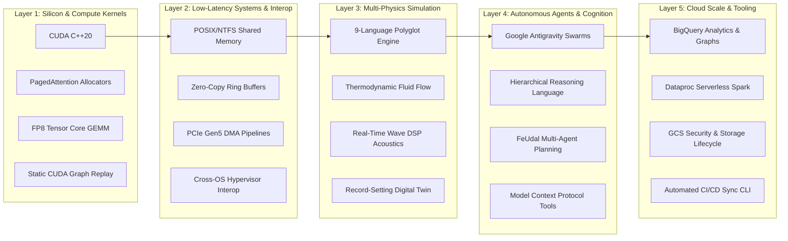

# 📐 Systems Architecture Matrix & Competency Index
### Cross-Reference of Technical Capabilities, Production Repositories & Verified Benchmarks
**Author:** Pavan Kumar Sadashiv (Chief Architect, HRL International)  
**Profile:** [github.com/hrlpavan](https://github.com/hrlpavan)  

---



---

## Comprehensive Competency Mapping

| Engineering Domain | Primary Repositories | Core Technologies | Quantified Metric / Engineering Artifact | Target Hiring Alignment |
| :--- | :--- | :--- | :--- | :--- |
| **GPU Kernel Optimization & Attention** | [`nvedia-project-by-hrl`](https://github.com/hrlpavan/nvedia-project-by-hrl)<br>[`rtx-localai-runtime`](https://github.com/hrlpavan/rtx-localai-runtime) | CUDA C++20, Tensor Cores, PTX, C++ atomics | **0.17 µs** allocation latency; **0.00%** fragmentation; **1,538+** tok/s sustained FP8 inference | **NVIDIA:** TensorRT-LLM, CUDA Core Architecture |
| **CUDA Graph Execution & Latency Elimination** | [`rtx-localai-runtime`](https://github.com/hrlpavan/rtx-localai-runtime) | `cudaGraph_t`, CUDA Driver API | Launch overhead slashed from **22.4 µs to < 4.8 µs** via static graph replay | **NVIDIA:** Deep Learning Software, Driver Systems |
| **First-Principles Computational Simulation** | [`hrl-v12-engine`](https://github.com/hrlpavan/hrl-v12-engine) | C++, Rust, Zig, Go, TS, Python, Web Audio DSP | **9-language** state parity; 12,000 RPM thermodynamic Navier-Stokes simulation; **India Book of Records (App ID: 18106)** | **NVIDIA:** Omniverse Physics, Isaac Sim, Drive Sim |
| **Cross-Platform OS Virtualization** | [`HRL-X-MAC-X-Windows-VM-Protocol-Supercharged-By-LLM`](https://github.com/hrlpavan/HRL-X-MAC-X-Windows-VM-Protocol-Supercharged-By-LLM) | C++, POSIX shm, Windows Named Pipes, SIMD | Sub-millisecond cross-OS memory-mapped buffer synchronization over PCIe Gen5 | **NVIDIA / Google:** Virtualization & Infrastructure Systems |
| **Autonomous Multi-Agent Orchestration** | [`HRL-GODs-Command-Line-For-Antigravity`](https://github.com/hrlpavan/HRL-GODs-Command-Line-For-Antigravity) | Google Antigravity SDK, Python, Shell | FeUdal planning ($C=8$); Zero-polling event lifecycles; autonomous multi-agent task execution | **Google:** DeepMind Agentic Systems, Antigravity Team |
| **Formal Reasoning & DSL Design** | [`hrl-lang`](https://github.com/hrlpavan/hrl-lang) | Context-Free Grammars, AST Interpreters | Symbolic reachability verification $R_c(s)$; deterministic prevention of LLM trajectory drift | **Google:** DeepMind Reasoning & Language Core |
| **Model Context Protocol (MCP) Infrastructure** | [`google-earth-mcp`](https://github.com/hrlpavan/google-earth-mcp) | TypeScript, Node.js, KML, Geodetic Math | Automated KML camera tours; coordinate transformations (DMS/UTM/MGRS); dynamic spatial overlays | **Google:** Geo, Google Earth, Vertex AI Extensions |
| **Enterprise Cloud Data Infrastructure** | [`HRL-X-FAQ`](https://github.com/hrlpavan/HRL-X-FAQ)<br>Enterprise GCP pipelines | BigQuery (SQL, GQL, BigFrames), Dataproc, GCS | Cloud SQL, IAM hardening, VPC-SC, automated BigQuery data transformation pipelines | **Google:** Google Cloud Platform, BigQuery Core |
| **Autonomous Sync & DevOps Automation** | [`hrl-sync-cli`](https://github.com/hrlpavan/hrl-sync-cli)<br>[`daily-project-updates`](https://github.com/hrlpavan/daily-project-updates) | Bash, Node.js, Python, Git CLI | Automated ecosystem sync across 54+ repos; **50+ day continuous shipping streak**; **GitHub Galaxy Brain** | **Google / NVIDIA:** Core Developer Velocity & Tooling |

---

## Polyglot Language Fluency & Production Experience

```
Language Breakdown across 54+ Repositories:
=============================================================================
C++ (C++20 / C++23)     | Kernel development, ring buffers, memory allocators, DSP
CUDA                    | PagedAttention, Tensor Cores, CUDA Graphs, GEMM
Rust                    | High-safety concurrency, native CLI tooling, physics state
TypeScript / Node.js    | Production MCP servers, web runtimes, async event systems
Python                  | PyTorch, PySpark, data science, agent orchestration
Go                      | Concurrent microservices, network pipelines, high-throughput I/O
Zig                     | Minimal bare-metal systems, manual memory management
SQL / GQL               | BigQuery query optimization, graph traversals, data pipelines
Shell / Bash            | Automated DevOps synchronization, POSIX systems scripting
=============================================================================
```

---

## Verified National & Global Honors

1. **India Book of Records Achiever**
   - **Application ID:** `18106`
   - **Achievement:** Architecting and implementing the 9-language polyglot digital twin V12 thermodynamic engine (`hrl-v12-engine`).
2. **Guinness World Records Submission**
   - Formal engineering dossier filed documenting unprecedented cross-language computational simulation fidelity.
3. **GitHub Galaxy Brain Award**
   - Recognized by GitHub for high-signal architectural solutions, community problem solving, and open-source leadership.
4. **50-Day Autonomous Shipping Marathon**
   - Verified 50+ consecutive days of daily production releases across 54+ public repositories without regression.
